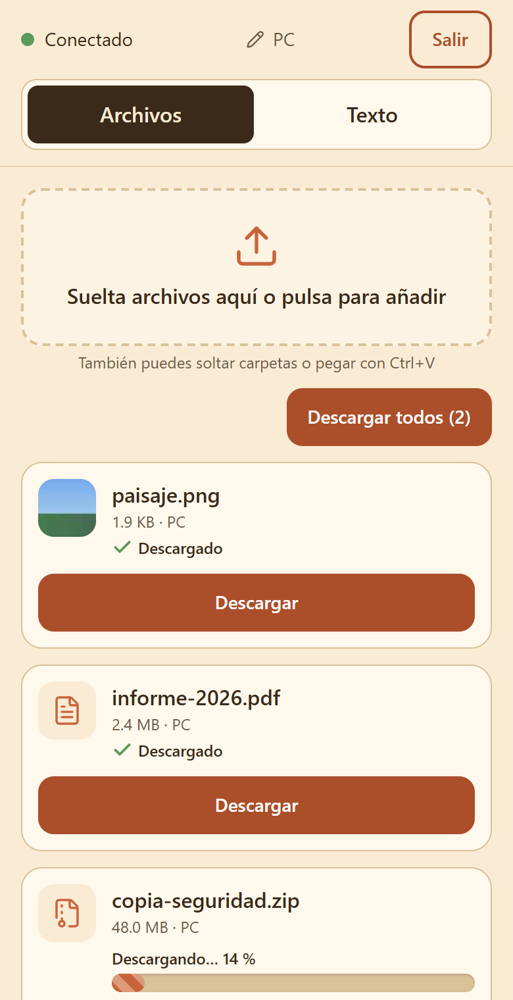
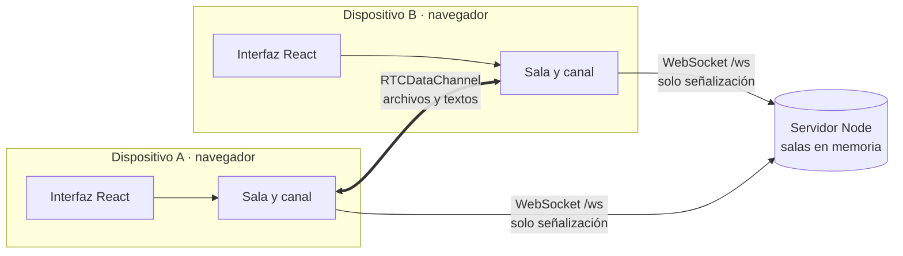

<div align="center">


# Transferir

**Pasa archivos y textos entre tus dispositivos, sin subirlos a ningún sitio.**

Aplicación web personal para enviar archivos y textos entre dos dispositivos emparejados con un código. Los datos viajan directamente entre ambos por WebRTC; el servidor solo sirve de puente para conectarlos y no guarda nada.


[Cómo arrancarlo en casa](docs/arranque.md) · [Seguridad](docs/seguridad.md) · [Plan de implementación](docs/plan.md)

</div>

---

## Índice

- [Captura](#captura)
- [Descripción](#descripción)
- [Funcionalidades](#funcionalidades)
- [Arquitectura](#arquitectura)
- [Puesta en marcha en desarrollo](#puesta-en-marcha-en-desarrollo)
- [Despliegue en casa](#despliegue-en-casa)
- [Scripts](#scripts)
- [Seguridad](#seguridad)
- [Estructura del proyecto](#estructura-del-proyecto)
- [Autor](#autor)

## Captura

<div align="center">



</div>

## Descripción

Transferir es una web pensada para uso personal: creas una sala en un dispositivo, introduces el código en el otro y ya podéis enviaros archivos y textos en ambos sentidos. La sala caduca si nadie se une y se borra todo al cerrarla.

- **Sin nube:** el contenido nunca pasa por el servidor. Va cifrado de extremo a extremo por el canal WebRTC (DTLS).
- **Sin cuentas:** no hay registro ni base de datos; el emparejamiento se hace con un código de 8 caracteres.
- **Sin instalación en los otros dispositivos:** basta con abrir la dirección en el navegador.
- **Pensada para móvil y PC:** la interfaz se adapta desde 360 px.
- **Solo en tu red:** los dos dispositivos deben estar en la misma red local; no hay servidor TURN, así que no está pensada para conectar desde fuera de casa.

## Funcionalidades

| Área               | Qué ofrece                                                                                                                              |
| ------------------ | --------------------------------------------------------------------------------------------------------------------------------------- |
| **Salas**          | Código de 8 caracteres (`XXXX-XXXX`) que caduca a los 5 minutos si nadie se une. Sala de dos dispositivos como máximo.                  |
| **Emparejamiento** | Enlace o código QR para unirse. Quien crea la sala debe aceptar al otro dispositivo.                                                    |
| **Archivos**       | Envío en bloques de 64 KB con control de flujo, miniaturas de imágenes, velocidad y tiempo restante, y descarga de todos a una carpeta. |
| **Textos**         | Envío de textos de hasta 1 MB, con resaltado de sintaxis cuando el contenido es código, y botón para vaciar los propios.                |
| **Reconexión**     | Si un dispositivo se cae, la sala le espera 2 minutos para volver con el mismo identificador.                                           |
| **Avisos**         | Confirmación antes de salir con transferencias en curso y aviso en el título de la pestaña cuando llega algo con la pestaña oculta.     |
| **Nombre**         | Cada dispositivo puede tener un nombre editable visible para el otro.                                                                   |

## Arquitectura



- **Señalización:** el servidor solo reenvía el saludo WebRTC (SDP y candidatos ICE) entre los dos dispositivos de una sala. Nunca ve contenido.
- **Datos:** el `RTCDataChannel` se abre directamente entre los navegadores. Quien se une ofrece la conexión y quien espera responde.
- **Contrato único:** los mensajes cliente-servidor, dispositivo-dispositivo y las constantes compartidas viven en `shared/`.
- **Validación:** todo lo que llega por el canal se trata como entrada no fiable: tipos, tamaños, identificadores y nombres de archivo se sanean antes de usarse.
- **Servidor:** HTTP para la web estática y `/health`, WebSocket en `/ws`, caducidad de salas y límite de intentos fallidos por IP. Sin base de datos.

## Puesta en marcha en desarrollo

### Requisitos

- [Node.js](https://nodejs.org/) 24 o superior
- [pnpm](https://pnpm.io/) 12 (único gestor soportado)

### Instalación

```bash
git clone https://github.com/n3brrr/transfer.git
cd transfer
pnpm install
```

Arranca el servidor y el cliente en dos terminales:

```bash
pnpm dev:server   # servidor en http://localhost:8080
pnpm dev:client   # Vite en http://localhost:5173 (redirige /ws al servidor)
```

Para probar la transferencia necesitas dos navegadores o dos ventanas en modo privado: una crea la sala y la otra se une con el código.

## Despliegue en casa

Hay dos formas de ejecutarla en un PC de casa con Docker Desktop. La guía paso a paso de ambas está en [`docs/arranque.md`](docs/arranque.md).

### Modo rápido: bajo demanda, solo en tu red, sin HTTPS

Un solo contenedor que arrancas cuando lo necesitas y que desaparece al pararlo. No hace falta dominio ni `.env`.

```bash
docker compose -f docker-compose.local.yml up --build
```

Abre `http://IP-DE-TU-PC:8080` en el PC y en el móvil, conectados a la misma Wi-Fi (la primera vez hay que permitir el puerto 8080 en el firewall de Windows, en la red Privada). Para pararlo, `Ctrl+C`. Sin HTTPS, en el móvil no están el botón Pegar ni el aviso de pantalla encendida; el resto funciona igual y los datos van cifrados por WebRTC.

### Con dominio y HTTPS

Detrás de Caddy, con un dominio de [DuckDNS](https://www.duckdns.org/) y acceso solo desde la red local. En resumen:

1. Copia `.env.example` a `.env` y rellena `DOMAIN`, `DUCKDNS_TOKEN` y `BIND_IP`.
2. Arranca los contenedores:
   ```bash
   docker compose up -d --build
   ```
3. Abre `https://TU_DOMINIO` desde cualquier dispositivo de la red de casa.

> ⚠️ La aplicación está pensada solo para la red de casa. No redirijas puertos del router ni actives DMZ o UPnP hacia este PC. Detalles en [`docs/seguridad.md`](docs/seguridad.md).

## Scripts

| Comando                  | Descripción                                                               |
| ------------------------ | ------------------------------------------------------------------------- |
| `pnpm dev:server`        | Servidor en desarrollo con recarga automática (`tsx watch`), puerto 8080. |
| `pnpm dev:client`        | Servidor de desarrollo de Vite con proxy de `/ws` al servidor.            |
| `pnpm build`             | Compila la web en `client/dist`.                                          |
| `pnpm build:server`      | Compila el servidor en `dist-server/` (usado por Docker).                 |
| `pnpm start`             | Ejecuta el servidor sirviendo `client/dist` (tras `pnpm build`).          |
| `pnpm test`              | Ejecuta Vitest. Los tests están aplazados por ahora.                      |
| `pnpm exec tsc --noEmit` | Comprueba los tipos de todo el proyecto.                                  |

## Seguridad

- **Datos fuera del servidor:** archivos y textos viajan por WebRTC; el servidor solo ve el saludo de conexión y no escribe nada en disco (`read_only` en Docker).
- **Entrada no fiable:** lo que llega del otro dispositivo se valida (también las miniaturas y el nombre del dispositivo) y se sanean los nombres de archivo antes de guardarlos o mostrarlos.
- **Cabeceras:** Content Security Policy y demás cabeceras definidas en el servidor; el WebSocket solo acepta el origen configurado.
- **Emparejamiento:** quien crea la sala debe aceptar o rechazar a cada dispositivo que quiere unirse (60 s de margen), aunque tenga el código.
- **Límites:** 10 salas creadas por minuto y por IP, intentos fallidos de unirse limitados por IP y minuto, y caducidad de salas.
- **Contenedores:** la app corre como usuario sin privilegios, sin capacidades de Linux y con límites de memoria y procesos.
- **Riesgos conocidos:** están documentados y aceptados en [`docs/seguridad.md`](docs/seguridad.md).

## Estructura del proyecto

```text
transferir/
├── client/
│   └── src/
│       ├── screens/       # Pantallas: Inicio, Sala creada, Archivos, Texto
│       ├── ui/            # Piezas reutilizables (cabecera, QR, portapapeles…)
│       ├── net/           # Señalización WebSocket y conexión WebRTC
│       ├── files/         # Troceado, transferencia, validación y miniaturas
│       └── state/         # Estado de la sala y de los mensajes
├── server/                # Salas, límite de intentos y servidor HTTP/WebSocket
├── shared/                # Protocolo y generación de tokens (cliente y servidor)
├── docker/                # Dockerfiles y Caddyfile
├── docs/                  # Plan, guía de arranque y seguridad
├── docker-compose.yml        # App + Caddy con DuckDNS (HTTPS)
├── docker-compose.local.yml  # Modo rápido: un contenedor, solo LAN, bajo demanda
└── .env.example              # Variables necesarias (sin valores)
```

## Autor

Desarrollado por [@n3brrr](https://github.com/n3brrr).

<div align="center">

Si el proyecto te resulta útil, deja una ⭐ en el repositorio.

</div>
